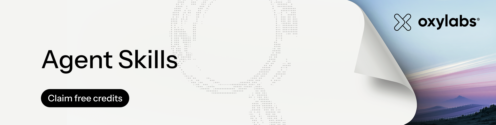

# Oxylabs Agent Skills
[](https://oxylabs.io/web-api-early-access?utm_source=github&utm_medium=referral&utm_content=agent-skills&utm_campaign=banner&groupid=877)

<p align="left">
  <a href="https://dashboard.oxylabs.io"></a>
  <a href="https://developers.oxylabs.io/products/web-api?utm_source=github&utm_medium=referral&utm_content=agent-skills&utm_campaign=banner&groupid=877"></a>
  <a href="https://dashboard.oxylabs.io"></a>
  <a href="https://discord.gg/Pds3gBmKMH"></a>
  <a href="https://www.youtube.com/@oxylabs"></a>
</p>

Official agent skills for Oxylabs products. Each skill provides structured instructions that AI agents can use to interact with Oxylabs services.

## Available Skills

| Skill | Directory | Description |
|-------|-----------|-------------|
| Proxies | [`skills/proxies`](skills/proxies/SKILL.md) | Residential, Mobile, Datacenter, Dedicated Datacenter, ISP and Dedicated ISP proxy network with geo-targeting, IP rotation, and session persistence |
| Web Unblocker | [`skills/web-unblocker`](skills/web-unblocker/SKILL.md) | AI-powered proxy that handles fingerprinting, JavaScript rendering, CAPTCHAs, and improves access reliability automatically |
| Web Scraper API | [`skills/web-scraper-api`](skills/web-scraper-api/SKILL.md) | Production-grade web scraping with structured JSON parsing for 40+ targets and geo-targeting |
| Agent Browser | [`skills/agent-browser`](skills/agent-browser/SKILL.md) | Remote agent browsers via CDP (Playwright/Puppeteer) with built-in request handling and residential proxies |
| Video Data | [`skills/video-data`](skills/video-data/SKILL.md) | Video data extraction (metadata, subtitles, search, channels) and high-bandwidth proxy video downloads |

## Product Routing

| Need | Use |
|------|-----|
| Bring your own HTTP client, proxy auth, IP rotation, sticky sessions, or raw geo-targeted proxy traffic | Proxies |
| Fetch protected pages without browser interactions | Web Unblocker |
| Get structured data from supported targets, search results, e-commerce pages, or parsed JSON | Web Scraper API |
| Clicks, forms, screenshots, browser state, or Playwright/Puppeteer automation | Agent Browser |
| YouTube metadata, subtitles, search, channel data, or video/audio downloads | Video Data |

Start with the most specific product that fits the task. Validate one small request first, confirm auth, status, and expected output, then scale with explicit limits.


## Installation

### Claude Code (plugin marketplace)

Inside Claude Code, run:

```
/plugin marketplace add oxylabs/agent-skills
/plugin install oxylabs@oxylabs-agent-skills
```

This installs all 5 skills as a single plugin. To update later:

```
/plugin marketplace update oxylabs-agent-skills
```

### Other agents (generic)

```bash
npx skills add https://github.com/oxylabs/agent-skills.git
```

## Configuration

All skills authenticate via environment variables defined in a `.env` file.

| Variable | Used By | Description |
|----------|---------|-------------|
| `OXY_RES_USERNAME` | Residential/Mobile Proxies | Residential or Mobile proxy username |
| `OXY_RES_PASSWORD` | Residential/Mobile Proxies | Residential or Mobile proxy password |
| `OXY_DC_USERNAME` | Datacenter/ISP Proxies | Datacenter or ISP proxy username |
| `OXY_DC_PASSWORD` | Datacenter/ISP Proxies | Datacenter or ISP proxy password |
| `OXYLABS_USERNAME` | Web Unblocker | Web Unblocker username |
| `OXYLABS_PASSWORD` | Web Unblocker | Web Unblocker password |
| `OXY_WSA_USERNAME` | Web Scraper API, Video Data | Web Scraper API username |
| `OXY_WSA_PASSWORD` | Web Scraper API, Video Data | Web Scraper API password |
| `OXY_AB_USERNAME` | Agent Browser | Agent Browser username |
| `OXY_AB_PASSWORD` | Agent Browser | Agent Browser password |
| `OXY_HB_ENDPOINT` | Video Data | Dedicated high-bandwidth proxy endpoint (for video downloads) |

Read more on our [agent skills documentation](https://developers.oxylabs.io/products/proxies/residential-proxies/agent-skills/?utm_source=github&utm_medium=referral&utm_content=agent-skills&groupid=877)
